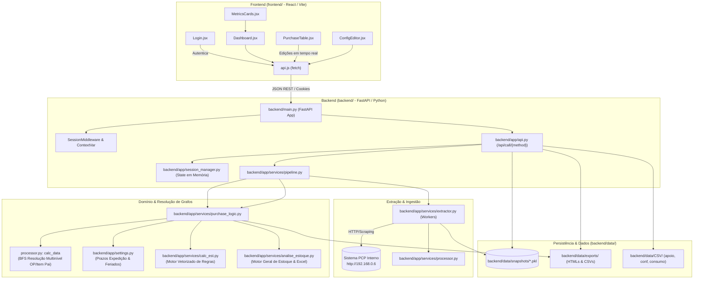

# Visão Geral: Analise_compras

**Resumo:** Sistema corporativo de inteligência e planejamento de compras (MRP/PCP), responsável pela extração paralela de ordens de produção e estoques, resolução de árvores de consumo multinível (grafos top-down), cálculo de necessidade líquida de compras e interface interativa em React para tomada de decisão e geração de Ordens de Compra (OCs).

## Arquitetura e Fluxo

## Índice de Módulos

### 01. Frontend UI (`frontend/`)
- [[01-Frontend-UI/React_App]]: Estrutura base da SPA React (`frontend/src/App.jsx`, `frontend/src/main.jsx`).
- [[01-Frontend-UI/Componente_Login]]: Formulário de autenticação e seleção de tipo de análise (`frontend/src/components/Login.jsx`).
- [[01-Frontend-UI/Componente_Dashboard]]: Painel analítico e barra de ferramentas (`frontend/src/components/Dashboard.jsx`).
- [[01-Frontend-UI/Componente_PurchaseTable]]: Tabela de compras com edição inline e filtros (`frontend/src/components/PurchaseTable.jsx`).
- [[01-Frontend-UI/Componente_MetricsCards]]: Resumo financeiro consolidado por família e totais (`frontend/src/components/MetricsCards.jsx`).
- [[01-Frontend-UI/Componente_ConfigEditor]]: Editor visual dos parâmetros de cálculo (`frontend/src/components/ConfigEditor.jsx`).
- [[01-Frontend-UI/Componente_Header_Sidebar]]: Navegação lateral e cabeçalho institucional (`frontend/src/components/Header.jsx`, `Sidebar.jsx`).
- [[01-Frontend-UI/Frontend_API_Client]]: Camada de transporte HTTP/fetch com suporte a sessões (`frontend/src/services/api.js`).
- [[01-Frontend-UI/Legacy_WebView_UI]]: Interface legada desktop pywebview mantida para compatibilidade (`backend/app/ui/`).

### 02. Backend API (`backend/`)
- [[02-Backend-API/Main_Server]]: Servidor FastAPI, middlewares e entrega de assets (`backend/main.py`).
- [[02-Backend-API/API_Router]]: Endpoints de roteamento RPC `/call/{method}` (`backend/app/api.py`).
- [[02-Backend-API/Session_Manager]]: Gerenciador de sessões em memória com TTL e thread-safety (`backend/app/session_manager.py`).

### 03. Domínio e Cálculos (`backend/app/services/`)
- [[03-Dominio-Calculos/Motor_Analise_Estoque_Geral]]: Motor de inteligência de compras e análise de estoque geral baseado na planilha corporativa (`backend/app/services/analise_estoque.py`).
- [[03-Dominio-Calculos/Regra_Compra_Necessidade]]: Algoritmo MRP para falta, lote mínimo/econômico e data ideal (`backend/app/services/purchase_logic.py`).
- [[03-Dominio-Calculos/Regra_Rateio_Consumo_Grafo]]: Resolução em grafo BFS da hierarquia de itens de manufatura (`backend/app/services/processor.py`).
- [[03-Dominio-Calculos/Regra_Calculo_Estoque_Regras]]: Motor declarativo de regras de estoque e cobertura (`backend/app/services/calc_est.py`).
- [[03-Dominio-Calculos/Regra_Prazos_Expedicao_Feriados]]: Regras de prazos por representante e offset de dias úteis com feriados (`backend/app/settings.py`).

### 04. Infraestrutura e Dados (`backend/app/` e `backend/data/`)
- [[04-Infra-Dados/Extrator_PCP]]: Coletor paralelo via web scraping multi-thread (`backend/app/services/extractor.py`).
- [[04-Infra-Dados/Pipeline_Coleta]]: Orquestrador ponta-a-ponta entre coleta, limpeza e regras (`backend/app/services/pipeline.py`).
- [[04-Infra-Dados/Processador_Dados]]: Utilitários de sanitização estatística de dataframes e ETL (`backend/app/services/processor.py`).
- [[04-Infra-Dados/Configuracoes_Settings]]: Constantes globais, caminhos centralizados e mapeamentos (`backend/app/settings.py`).
- [[04-Infra-Dados/Modelos_Schemas]]: Modelos e schemas de dados Pydantic / Dataclasses (`backend/app/models/schemas.py`).

### 05. Automações (`backend/scripts/`)
- [[05-Automacoes/Script_Carrega_Dados]]: Pipeline batch de extração e tratamento local de CSVs e snapshots (`backend/scripts/carrega_dados.py`).
- [[05-Automacoes/Script_Extracao_Feriados]]: Crawler automático de feriados corporativos da intranet PCP (`backend/app/feriados.py`).

### 06. Documentação & Conhecimento (`documentacao/`)
- **`documentacao/vault/`**: Vault central do Obsidian com notas técnicas, especificações dos componentes e o diário de bordo (`Analise_compras-logbook/`).
- **`documentacao/referencias/`**: Documentos de apoio, especificações de negócio (DOCX), regras legadas e assets/guias de UI/UX.
